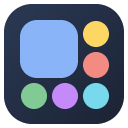

<p align="center">
  
</p>

<h1 align="center">Mi Nueva Pestaña · My New Tab</h1>

<p align="center">
  Una nueva pestaña para Chrome que funciona como la pantalla de inicio de tu celular.<br>
  <em>A Chrome new tab that works like your phone's home screen.</em>
</p>

<p align="center">
  
  
  
  
</p>

> **Versión preliminar.** Todavía no está en la Chrome Web Store y puede cambiar.
> *Preview release: not yet on the Chrome Web Store, and things may change.*

[Español](#español) · [English](#english)

---

## Español

### Qué hace
- **Accesos ilimitados en varias pantallas**, con flechas laterales, rueda del mouse o puntos para moverte.
- **Cada pantalla tiene los espacios que tú eliges** (por ejemplo 3×3, o una fila de 3 y otra de 4) y **sin scroll**.
- **Colocación libre, como en Android:** arrastras un icono a cualquier hueco; si lo sueltas sobre otro se crea una carpeta, y en el borde se intercambian.
- **Tamaños y formas:** normal, ancho, alto y grande; círculo, redondeado, cuadrado, hexágono, estrella, triángulo y corazón.
- **Tu barra de marcadores** dentro de la página, con carpetas y submenús.
- **Clic derecho** en iconos, marcadores y espacios vacíos: abrir en pestaña, ventana o incógnito; editar; mover…
- **Mouse, pantalla táctil y lápiz.** Mantén presionado un icono para editar.
- **Deshacer** (`Ctrl+Z`) y **copias automáticas** diarias.
- **Personalización:** colores, transparencias, imagen de fondo y tema claro u oscuro.
- **Extras opcionales** (apagados de fábrica): reloj, notas y tareas; nombre y fondo por pantalla; otro buscador para una búsqueda puntual.
- **Español e inglés**, según el idioma de Chrome.

### Instalarla desde el código
1. Descarga el repositorio (botón **Code → Download ZIP**) y descomprímelo, o usa `git clone`.
2. Abre `chrome://extensions` y activa el **Modo de desarrollador**.
3. Pulsa **Cargar descomprimida** y elige la carpeta del proyecto.
4. Abre una pestaña nueva. Si Chrome pregunta si es la página que esperabas, elige **Conservar**.

### Privacidad
Todo se usa y se guarda **solo en tu computador**: la extensión no envía datos a ningún servidor, no tiene
anuncios ni analítica, y no carga nada desde internet. Detalle completo en [PRIVACY.md](PRIVACY.md).

### Para desarrolladores
- **HTML, CSS y JavaScript escritos a mano, sin librerías ni proceso de compilación.** Editas, pulsas ↻ en
  `chrome://extensions`, y listo.
- La arquitectura, el modelo de datos y las decisiones de rendimiento están en
  [docs/ARQUITECTURA.md](docs/ARQUITECTURA.md).
- `python tools/build_zip.py` arma el paquete para la tienda en `dist/`.
- `python tools/make_icons.py` vuelve a generar los íconos desde el diseño de `icons/icon.svg`.
- Los textos están en `js/i18n.js` (`clave: [español, inglés]`). Agregar un idioma es sumar una columna.

```
manifest.json · newtab.html · css/ · js/ · icons/ · _locales/   la extensión
docs/      documentación técnica
store/     textos para la Chrome Web Store
tools/     scripts de íconos y empaquetado
```

---

## English

### What it does
- **Unlimited shortcuts across several screens**, with side arrows, mouse wheel or dots to move around.
- **Each screen has the spaces you choose** (e.g. 3×3, or a row of 3 and a row of 4) and **no scrolling**.
- **Free placement, Android style:** drag an icon to any empty spot; drop it on another to make a folder, or on its edge to swap them.
- **Sizes and shapes:** normal, wide, tall and large; circle, rounded, square, hexagon, star, triangle and heart.
- **Your bookmarks bar** inside the page, with folders and submenus.
- **Right-click** icons, bookmarks and empty spots: open in a tab, window or incognito; edit; move…
- **Mouse, touchscreen and pen.** Press and hold an icon to edit.
- **Undo** (`Ctrl+Z`) and **automatic daily backups**.
- **Customization:** colors, transparency, background image and light or dark theme.
- **Optional extras** (off by default): clock, notes and to-dos; name and background per screen; another search engine for a single search.
- **Spanish and English**, following Chrome's language.

### Install from source
1. Download the repository (**Code → Download ZIP**) and unzip it, or use `git clone`.
2. Open `chrome://extensions` and turn on **Developer mode**.
3. Click **Load unpacked** and pick the project folder.
4. Open a new tab. If Chrome asks whether this is the page you expected, choose **Keep it**.

### Privacy
Everything is used and stored **only on your computer**: the extension sends no data to any server, has no
ads or analytics, and loads nothing from the internet. Full details in [PRIVACY.md](PRIVACY.md).

### For developers
- **Handwritten HTML, CSS and JavaScript, with no libraries and no build step.** Edit, click ↻ in
  `chrome://extensions`, done.
- Architecture, data model and performance notes (in Spanish): [docs/ARQUITECTURA.md](docs/ARQUITECTURA.md).
- `python tools/build_zip.py` builds the store package in `dist/`.
- `python tools/make_icons.py` regenerates the icons from the `icons/icon.svg` design.
- UI strings live in `js/i18n.js` (`key: [Spanish, English]`). Adding a language means adding a column.

---

## Licencia · License

Copyright © 2026 FHX23

Este programa es software libre: puedes redistribuirlo y modificarlo bajo los términos de la
**Licencia Pública General de GNU, versión 3** ([LICENSE](LICENSE)). Las versiones modificadas que
distribuyas también deben publicarse con su código bajo la misma licencia.

*This program is free software: you can redistribute it and/or modify it under the terms of the
**GNU General Public License v3.0** ([LICENSE](LICENSE)). Modified versions you distribute must also be
released with their source code under the same license.*
